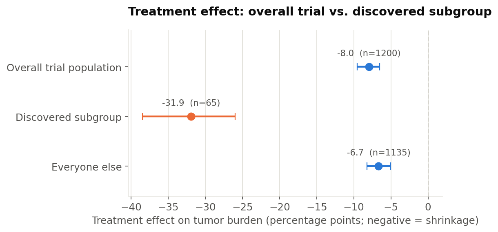

# Patient Population Selection for Optimal Drug Performance

## Background 

A demonstration of using machine learning (ML) to find the **narrowest patient
population for which a drug actually works**, instead of settling for a single
average treatment effect across an entire trial. Rather than evaluating whether a drug works for the "average" patient in a trial, machine learning is used to uncover the specific subgroup of patients who will derive a data-driven, signficant benefit from it. 

In the majority of standard Phase II/III clinical trials, researchers focus on the Average Treatment Effect (ATE):
$$\text{ATE} = \mathbb{E}[Y(1) - Y(0)]$$
in which they take the average outcome of the treatment arm minus the average outcome of the control arm across all enrolled participants [(1)](https://pubmed.ncbi.nlm.nih.gov/37148125/).

The drawback of looking at ATE is that averages hide biological heterogeneity. If a drug delivers a profound response in a distinct subset of patients but has minimal or negative effects in the rest, the overall clinical signal gets diluted across the entire cohort. In traditional trial analysis, that dilution makes the drug appear ineffective on aggregate, risking the abandonment of a therapy that could be life-changing for the responsive subgroup [(2)](https://www.elucidata.io/glossary/patient-stratification).

Therefore, using ML to stratify patient populations based on multi-omics health data can help to advance drugs for only the precise population that it benefits. 

## The idea

A randomized controlled trial usually reports one number: the average treatment
effect across everyone enrolled. That number can be quietly misleading. A drug that
looks like a modest, unremarkable success on average might actually work
dramatically well for a specific, identifiable subset of patients — and only
marginally (or not at all) for everyone else. Precision oncology already runs on
this idea (eg. trastuzumab in HER2-positive breast cancer, osimertinib in EGFR-mutant
lung cancer); the question here is how you'd actually *find* that subgroup from
trial data using ML, and how you'd know whether you could trust what you found.

This repo builds and validates a full pipeline for that: simulate a trial with a
known (but hidden) responder subgroup, estimate individual-level treatment effects
with a cross-fitted causal ML model, compress those estimates into a short,
human-readable eligibility rule, and grade the result against the ground truth.

**Everything here uses simulated data.** With a real trial, each patient only ever
reveals one outcome — treated *or* control, never both — so the true individual
treatment effect is never observable, which makes it impossible to check whether a
stratification method found the *right* subgroup or just something that looked good
by chance. Simulating the trial means the data-generating process is known, so the
pipeline can be graded against a real answer key before anyone trusts it on data
where that answer key doesn't exist.

## The scenario

`ONCB-317` is a fictional targeted therapy for advanced non-small-cell lung cancer
(NSCLC), which will serve as the experimental group. This is tested against standard-of-care chemotherapy within a simulated 1,200-patient
randomized trial. The results will be collected at the end of 12 weeks of treatment, and the endpoint is percent change in tumor burden at 12 weeks
(negative = shrinkage).

Two kinds of baseline variables are built into the simulation on purpose, because
telling them apart is the whole point of a good stratification analysis:

- **Prognostic** variables (age, ECOG performance status, baseline tumor burden,
  comorbidity count, tumor mutational burden) affect the outcome in *both* arms —
  sicker patients do worse whether or not they get the drug.
- **Predictive** variables change the *size of the treatment effect itself*. Here,
  only EGFR mutation status and PD-L1 expression are predictive: patients who are
  EGFR-mutant **and** have high PD-L1 expression get a large extra benefit from the
  drug; everyone else gets, at most, a small background effect. This is modeled as a
  smooth function of PD-L1 (not a hard cutoff), so "discovering" the subgroup means
  approximating a threshold, not just recovering a rule that was written down in
  advance.

Full detail on the simulation is in `src/simulate_trial.py`; the reasoning is
written into the module docstring and repeated in the notebook.

## Method

| Step | Module | What it does |
|---|---|---|
| 1. Simulate the trial | `src/simulate_trial.py` | Generates the observed dataset (`data/trial_data.csv`) plus a separate ground-truth file (`data/ground_truth.json`) used only for grading, never as a model input. |
| 2. Estimate individual treatment effects | `src/modeling.py` | A cross-fitted T-learner: two random forests (treated arm, control arm), scored out-of-fold so no patient's estimate is contaminated by having been in that patient's own training set. |
| 3. Discover a subgroup | `src/subgroup_discovery.py` | Fits a shallow ("policy") decision tree to the estimated effects and reads off the leaves as candidate eligibility rules — the actual deliverable a protocol could use. |
| 4. Evaluate | `src/evaluate.py` | Observed treatment effect (difference-in-means with a bootstrap CI) inside vs. outside the discovered subgroup, plus — because this is simulated — precision/recall against the true responder label and calibration of estimated vs. true effect. |
| 5. Visualize | `src/plotting.py` | The plots used throughout the notebook. |

The full narrative, with every plot and every design decision explained inline, is
in **`notebooks/demo_walkthrough.ipynb`**.

## Results

| Group | n | Observed treatment effect (95% CI) |
|---|---|---|
| Overall trial population | 1,200 | -8.0 (-9.5, -6.5) |
| Discovered subgroup | 65 | **-31.9 (-38.5, -26.0)** |
| Everyone else | 1,135 | -6.7 (-8.2, -5.0) |

*(percentage points of additional tumor shrinkage; more negative = more benefit)*



The discovered rule — read straight off the policy tree — is:

> `egfr_mutation > 0.5 AND pdl1_expression_pct > 34.8 AND tumor_mutational_burden <= 8.7`

which recovers both variables that actually drive the true effect (EGFR status and
PD-L1 expression, with a cutoff close to the true ~50% threshold), plus one extra
condition that isn't part of the true rule — a realistic and expected amount of
noise from fitting one tree to one trial's worth of data, and exactly why a
discovered subgroup like this is a hypothesis for an independent validation cohort,
not a conclusion. Against the (otherwise hidden) ground truth, the discovered
subgroup scores 0.71 precision / 0.65 recall / 0.68 F1 at recovering the true
responder population.

## Repository structure

```
.
├── data/
│   ├── trial_data.csv          # the "observed" dataset (generated)
│   └── ground_truth.json       # true CATE + responder labels, for grading only (generated)
├── notebooks/
│   └── demo_walkthrough.ipynb  # the full narrative, with rendered outputs
├── results/                    # figures saved by the notebook / scripts
├── src/
│   ├── simulate_trial.py
│   ├── modeling.py
│   ├── subgroup_discovery.py
│   ├── evaluate.py
│   └── plotting.py
└── requirements.txt
```

## Running it

```bash
pip install -r requirements.txt

# Regenerate the trial data (deterministic; already committed under data/)
python src/simulate_trial.py

# Re-run the full notebook end-to-end and refresh results/
jupyter nbconvert --to notebook --execute --inplace notebooks/demo_walkthrough.ipynb
```

Or just open `notebooks/demo_walkthrough.ipynb` and run the cells — it already
contains rendered output, so you can also read it straight from GitHub without
running anything.

## Important Considerations

This is a demonstration of the *mechanics* of ML-based subgroup discovery, built so
the method can be checked against a known answer before it's trusted on real data.
It is not a validated approach ready to point at any actual trial. In particular:

- A discovered subgroup here is a hypothesis generated from **one** dataset. Real
  practice would require confirming it in an independent, ideally prospectively
  collected, validation cohort before it ever became an eligibility criterion.
- The T-learner + shallow policy tree combination is a reasonable, interpretable
  starting point, not necessarily the strongest available method. Causal forests,
  X-/R-learners, and doubly-robust estimators are natural next steps worth comparing
  against this baseline.
- Real trials bring complications this simulation deliberately sidesteps: censored
  survival endpoints, missing data, multiple correlated biomarkers, multiplicity
  correction across many candidate subgroups, and much smaller sample sizes for the
  subgroup of interest.

## References

- Künzel, S. R., Sekhon, J. S., Bickel, P. J., & Yu, B. (2019). *Metalearners for
  estimating heterogeneous treatment effects using machine learning.* PNAS.
- Athey, S., & Wager, S. (2021). *Policy learning with observational data.*
  Econometrica.
- Foster, J. C., Taylor, J. M. G., & Ruberg, S. J. (2011). *Subgroup identification
  from randomized clinical trial data.* Statistics in Medicine. (the "Virtual Twins"
  method)
